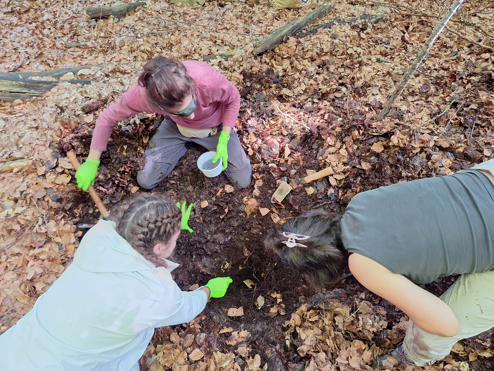
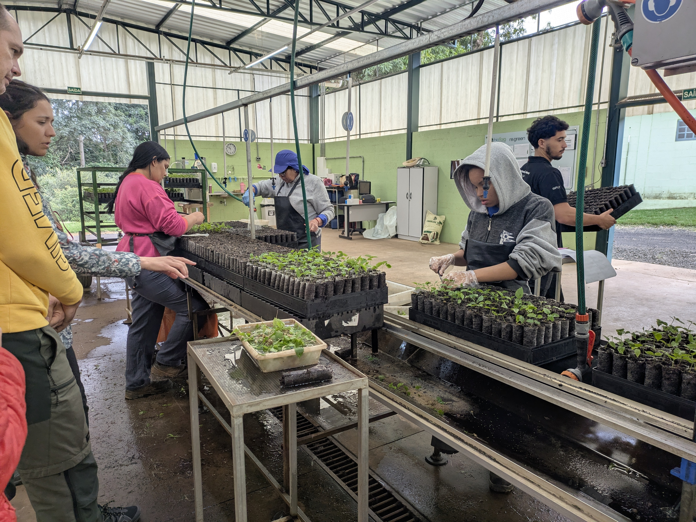
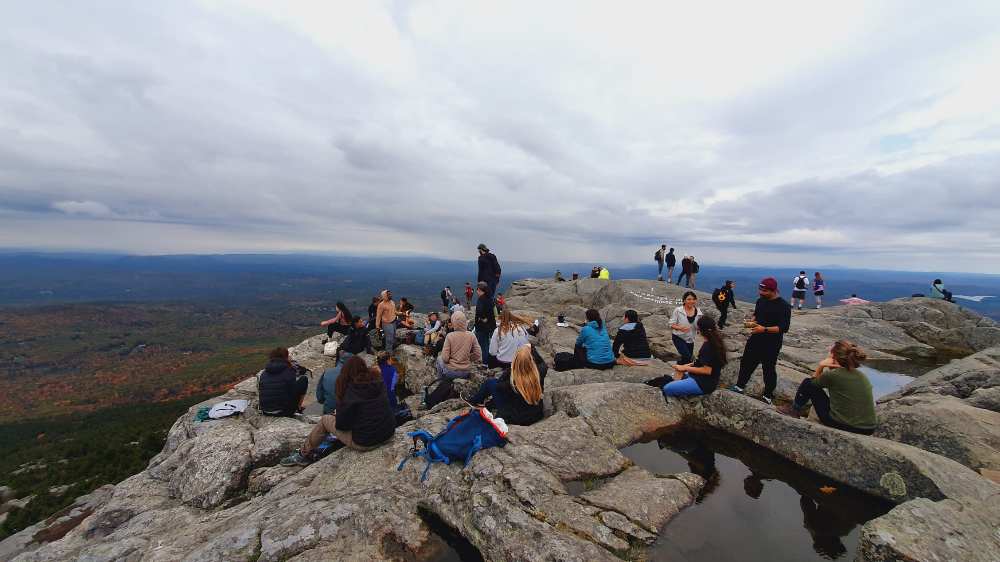

Actualmente participo en los siguientes proyectos de investigación:

## WILD2050

:::: {.project-entry}
::: {.project-visual}
{.project-image fig-alt="Renaturalización de paisajes agrarios en Cenicientos."}
:::

::: {.project-description}
**How can rewilding contribute to achieving the EU biodiversity and climate targets for 2050?**

WILD2050 evalúa el potencial de la renaturalización para restaurar la naturaleza en Europa de aquí a 2050. El proyecto estudia sus beneficios para la biodiversidad, la mitigación del cambio climático y la sociedad, y cómo estos pueden verse condicionados por los cambios en el clima y los usos del suelo futuro mediante un enfoque interdisciplinar. Dirijo el equipo español del consorcio que está liderado por Arndt Hampe de la Universidad de Burdeos. El proyecto ha sido financiado por el Ministerio de Ciencia, Innovación y Universidades y la Unión Europea a través del programa [Biodiversa+](https://www.biodiversa.eu/2025/09/09/2025-2026-joint-call/) para desarrollarse entre 2027 y 2029.

:::
::::

## Futures4Forests

:::: {.project-entry}
::: {.project-visual}
{.project-image fig-alt="Trabajo de campo en un sitio incendiado en el marco del proyecto Futures4Forests."}
:::

::: {.project-description}
**Learning from the past for redefining the trajectory of future forests**

En Futures4Forests estudiamos cómo cambia la composición de especies vegetales durante la recuperación de los bosques secundarios españoles y qué condiciones ambientales determinan sus trayectorias, con especial atención en las primeras etapas de sucesión. Dirijo este proyecto en la Universidad de Alcalá, con financiación del programa de Atracción de Talento "César Nombela" de la Comunidad de Madrid y un periodo de ejecución de 2025 a 2029.

:::
::::

## FUNFOREST

:::: {.project-entry}
::: {.project-visual}
{.project-image fig-alt="Muestreos de lombrices durante el proyecto FunForest en el PN de Ordesa."}
:::

::: {.project-description}
**Hacia una evaluación multiFUNcional de las estrategias de gestión FORESTal para la adaptación de los bosques al cambio climático**

FUNFOREST evalúa cómo las estrategias de gestión forestal pueden favorecer la adaptación al cambio climático de los bosques de los Parques Nacionales de montaña. El proyecto integra la productividad, el secuestro de carbono, la resistencia y resiliencia frente a perturbaciones, el ciclo de nutrientes y la conservación de la biodiversidad, incluida la del suelo. Está financiado por el Organismo Autónomo de Parques Nacionales y liderado por Enrique Andivia de la Universidad Complutense de Madrid.

:::
::::

## QueVADIS {width=4% fig-alt="Logo del proyecto QueVADIS. Por Eliot Mompean."}

:::: {.project-entry}
::: {.project-visual}

{.project-image fig-alt="Siembra experimental de bellotas de distintas especies de Quercus en Valdepeñas en el marco del proyecto QueVADIS."}
:::

::: {.project-description}
**Diferencias de colonización de quercíneas coexistentes: desde las propiedades y la dispersión de las bellotas a la facilitación**

QueVADIS estudia por qué distintas especies de *Quercus* que conviven en la península ibérica difieren en su capacidad de colonizar nuevos espacios. Analiza la regeneración, las características y la dispersión de las bellotas, y el papel de los arbustos que favorecen el establecimiento de nuevos árboles, combinando datos existentes con experimentos de campo y laboratorio. El proyecto está liderado por Pedro Villar de la Universidad de Alcalá. y financiado por el Ministerio de Ciencia e Innovación.
:::
::::

## Biases in forest restoration

:::: {.project-entry}
::: {.project-visual}
{.project-image fig-alt="Visita al vivero forestal Bioflora."}
:::

::: {.project-description}
**Identifying, quantifying, and accounting for biases in forest restoration**

Este proyecto analiza los sesgos de la investigación sobre restauración forestal que dificultan valorar su eficacia. Mediante la síntesis de la evidencia disponible y la colaboración de un equipo internacional, busca mejorar la base científica que orienta las decisiones de restauración. Cuenta con el apoyo de una *Synthesis Grant* de la *British Ecological Society* y está liderado por Phil Martin del Basque Centre for Climate Change.

[Más información · British Ecological Society](https://www.britishecologicalsociety.org/content/our-synthesis-grantee-researches-forest-restoration-biases/)
:::
::::

## ForestAssembly

:::: {.project-entry}
::: {.project-visual}

{.project-image fig-alt="Salida de campo con los estudiantes del GSD al Mount Monadnock."}
:::

::: {.project-description}
**Compartiendo información de comunidades de especies forestales del planeta de forma ética y reproducible**

En *ForestAssembly* estudiamos qué factores determinan la recuperación y la resiliencia de los bosques frente a perturbaciones naturales y humanas a escala global. Analizo cómo influyen la diversidad de especies, las condiciones ambientales y el paisaje circundante, combinando resultados de estudios publicados con bases de datos globales. El proyecto fue financiado por el [Real Colegio Complutense en la Universidad de Harvard](https://rcc.harvard.edu/) durante 2020 y 2021.

:::
::::
