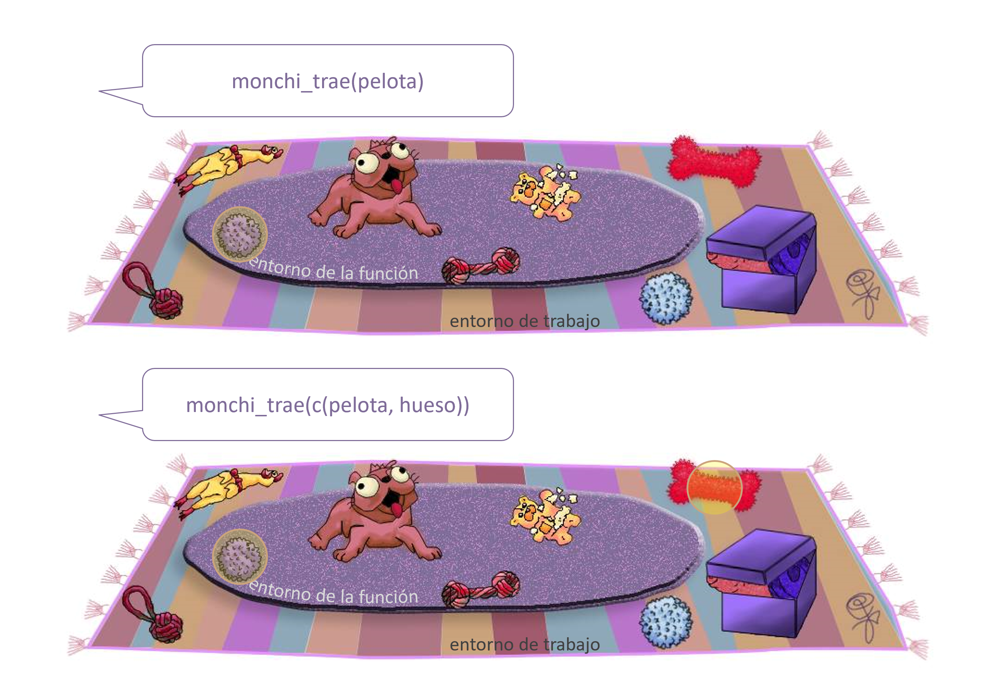

En [DatSciR](https://github.com/DatSciR) encontrarás todos los materiales de cursos y talleres que hemos impartido.

Te dejo aquí algunos de los más completos:

- [Git y GitHub](https://github.com/DatSciR/intro_git-github/tree/main/centra)

- [Programación funcional en R](https://github.com/DatSciR/intro_prog_fun/tree/main/transmitting_science)

- [Ciencia de datos](https://github.com/DatSciR/ciencia_datos/tree/main/CADIC_2024)

